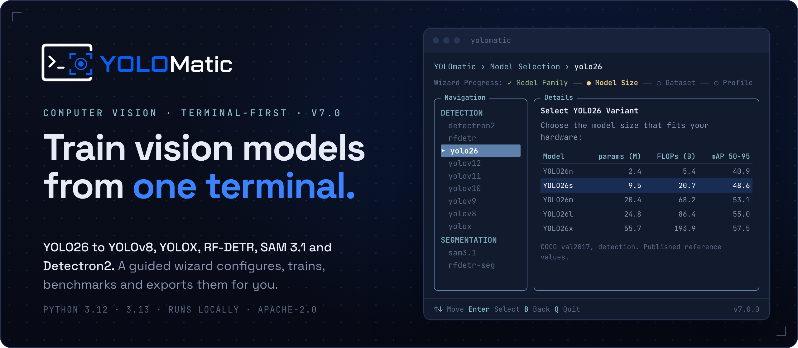
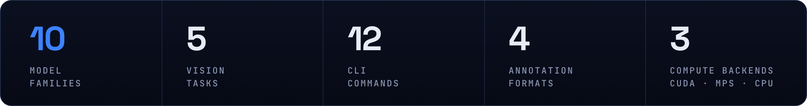
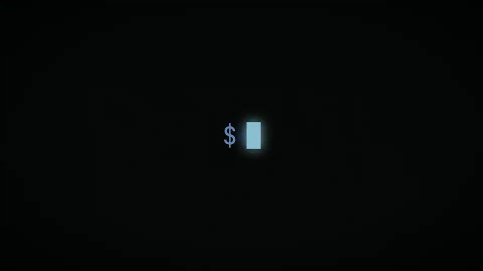
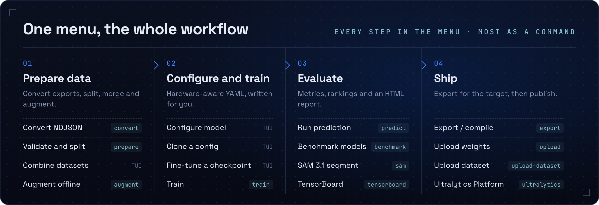
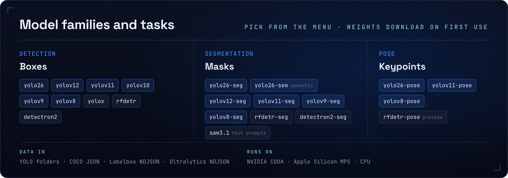
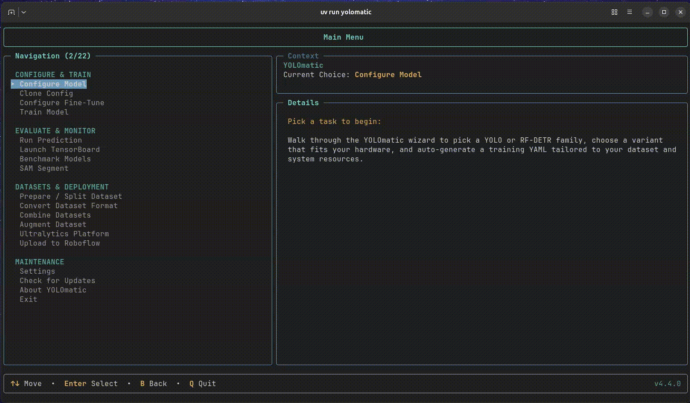
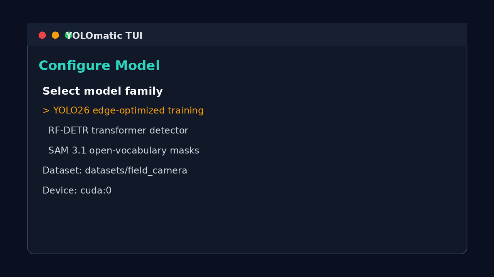
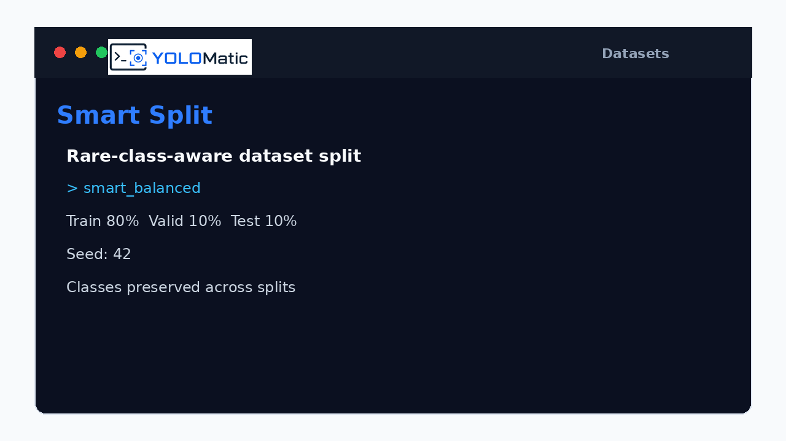

<p align="center">
  <a href="https://shahabahreini.github.io/YOLOMatic/"></a>
</p>

<p align="center">
  <a href="https://pypi.org/project/yolomatic/"></a>
  <a href="https://www.python.org/"></a>
  <a href="https://github.com/shahabahreini/YOLOMatic/actions"></a>
  <a href="https://github.com/shahabahreini/YOLOMatic/blob/main/LICENSE.md"></a>
  <a href="https://github.com/shahabahreini/YOLOMatic/stargazers"></a>
</p>

<p align="center">
  <a href="https://shahabahreini.github.io/YOLOMatic/"><b>Documentation</b></a> &nbsp;·&nbsp;
  <a href="#start-here"><b>Install</b></a> &nbsp;·&nbsp;
  <a href="#watch-the-showreel">Showreel</a> &nbsp;·&nbsp;
  <a href="#run-it-without-the-tui">Commands</a> &nbsp;·&nbsp;
  <a href="#frequently-asked-questions">FAQ</a> &nbsp;·&nbsp;
  <a href="https://github.com/shahabahreini/YOLOMatic/blob/main/CHANGELOG.md">Changelog</a>
</p>

<p align="center"></p>

# YOLOmatic

A terminal app for the whole computer-vision training loop. Pick a model from a menu, point it at a dataset, and YOLOmatic writes a training config sized for your hardware, trains it, benchmarks the result and exports it for deployment. It supports **YOLO26, YOLOv12, YOLO11, YOLOv10, YOLOv9, YOLOv8, YOLOX, RF-DETR, SAM 3.1 and Detectron2**, and everything runs on your own machine.

### Start here

```sh
uv tool install --python 3.12 yolomatic
yolomatic
```

That opens the interactive wizard. Use the arrow keys and Enter; every screen explains its options before you pick one. New to it? The [first training run guide](https://shahabahreini.github.io/YOLOMatic/getting-started/first-training-run/) walks through a complete run, from dataset to exported model.

## Watch the showreel

<p align="center">
  <a href="https://shahabahreini.github.io/YOLOMatic/assets/showreel/yolomatic-showreel.mp4"></a>
</p>

<p align="center"><sub>Every screen in the video is rebuilt from the real app's menus. <a href="https://shahabahreini.github.io/YOLOMatic/assets/showreel/yolomatic-showreel.mp4">Watch it in full resolution with sound</a> (1080p, 40 s).</sub></p>

## At a glance

| | |
|---|---|
| **Models** | YOLO26, YOLOv12, YOLO11, YOLOv10, YOLOv9, YOLOv8, YOLOX, RF-DETR, SAM 3.1, Detectron2 |
| **Tasks** | Detection, instance segmentation, semantic segmentation, pose, text-prompted segmentation |
| **Data** | YOLO folders, COCO JSON, Labelbox NDJSON, Ultralytics Platform NDJSON |
| **Hardware** | NVIDIA CUDA, Apple Silicon (MPS) or CPU, checked before training starts |
| **Deployment** | ONNX, TensorRT, OpenVINO, CoreML, TFLite, TorchScript, NCNN and the other Ultralytics formats |
| **Integrations** | Roboflow, ClearML, TensorBoard, Hugging Face, Ultralytics Platform |
| **Requirements** | Python 3.12 or 3.13 on Linux, macOS or Windows |
| **Licence** | [Apache 2.0](https://github.com/shahabahreini/YOLOMatic/blob/main/LICENSE.md) |

## What it does

<p align="center"></p>

- **Configs written for you.** The wizard reads your dataset and your hardware, then writes a training YAML with sensible batch size, workers and device. Save it, clone it for the next dataset, or fine-tune from an existing checkpoint.
- **Checks before it spends GPU hours.** CUDA/PyTorch mismatches and missing runtime libraries are caught before training starts, with a fix or a fallback offered.
- **Datasets in any shape.** Convert Labelbox and Ultralytics Platform NDJSON to YOLO or COCO, split with class- and object-size balancing, merge datasets, and build reproducible Albumentations copies that never overwrite the last good output.
- **Benchmarks you can read.** Compare checkpoints and exports on mAP@50, mAP@50:95, F1, precision and recall, with per-image rankings by object size and an interactive HTML report with UMAP embeddings.

## Model families and tasks

<p align="center"></p>

Pretrained weights download on first use. The [models guide](https://shahabahreini.github.io/YOLOMatic/guides/models/) covers which family suits which job, and the [RF-DETR](https://shahabahreini.github.io/YOLOMatic/guides/rf-detr/) and [SAM 3.1](https://shahabahreini.github.io/YOLOMatic/guides/sam/) guides cover their specifics.

## Install

The base install trains, predicts and benchmarks. Add extras for the features you need:

```sh
uv tool install --python 3.12 "yolomatic[export,sam]"
```

| Extra | Adds |
|---|---|
| `export` | ONNX, OpenVINO, NCNN, TensorFlow / TFLite and CoreML export |
| `tensorrt` | TensorRT engines (NVIDIA GPUs on Linux and Windows) |
| `sam` | SAM 3.1 fine-tuning and segmentation |
| `clearml` | ClearML experiment tracking |
| `viz` | UMAP embeddings in benchmark reports (PCA is used without it) |
| `all` | Everything above |

See the [install guide](https://shahabahreini.github.io/YOLOMatic/getting-started/install/) for CUDA setup and platform notes.

## Run it without the TUI

`yolomatic` on its own opens the main menu. Each step also has its own command. The scriptable ones take flags and run without prompts, which suits servers and CI; the others open that step's wizard directly.

```sh
yolomatic train --config configs/my_run.yaml
yolomatic predict --weight runs/detect/train/weights/best.pt --source images/
yolomatic export --weight runs/detect/train/weights/best.pt
yolomatic prepare --source exports/labels.ndjson --format "YOLO Detection" --smart-split
yolomatic tensorboard --port 6006
```

| Command | Does | Mode |
|---|---|---|
| `train` | Train from a saved config | Scriptable |
| `predict` | Run inference on an image or folder | Scriptable |
| `export` | Export a trained model to deployment formats | Scriptable |
| `prepare` | Validate, convert and split a dataset | Scriptable |
| `upload`, `upload-dataset` | Upload weights or a dataset to Roboflow | Scriptable |
| `ultralytics` | Ultralytics Platform helpers | Scriptable |
| `tensorboard` | Launch TensorBoard | Scriptable |
| `benchmark` | Benchmark and compare models on a dataset | Wizard |
| `augment` | Offline Albumentations augmentation | Wizard |
| `convert` | Convert NDJSON exports to YOLO / COCO | Wizard |
| `sam` | SAM 3.1 segmentation | Wizard |

Run `yolomatic <command> --help` for options. Exit codes: `0` success, `1` failure, `2` usage error or no terminal, `130` cancelled with Ctrl+C. Full reference: [CLI commands](https://shahabahreini.github.io/YOLOMatic/reference/cli-commands/).

## Inside the terminal

<p align="center"></p>

| Configure a model | Smart dataset split |
|---|---|
|  |  |

## How it compares

| | YOLOmatic | Ultralytics CLI | Roboflow | Hosted YOLO tools |
|---|---|---|---|---|
| Interactive terminal wizard | Yes | Limited | Web UI | Web UI |
| Native RF-DETR training | Yes | No | Deploy focused | Varies |
| SAM 3.1 and Detectron2 | Yes | No | Limited | Varies |
| Hardware-aware config generation | Yes | Manual | Abstracted | Abstracted |
| NDJSON to YOLO / COCO conversion | Yes | No | Import focused | Varies |
| Local benchmark HTML reports | Yes | Partial metrics | Hosted analytics | Varies |
| Fully local workflow | Yes | Yes | No | No |

More detail on the [comparison page](https://shahabahreini.github.io/YOLOMatic/comparison/).

## Frequently asked questions

**Do I need a GPU?**
No. A CUDA GPU is recommended for training, but Apple Silicon (MPS) and CPU work too. If PyTorch cannot see a GPU that is present, YOLOmatic says so before training and offers a repair path or a CPU fallback.

**Is it only for YOLO?**
No. RF-DETR, SAM 3.1 and Detectron2 are trained natively, not through a YOLO wrapper.

**Does my data leave my machine?**
Not unless you ask it to. Training, benchmarking and export run locally; Roboflow, ClearML and Ultralytics Platform are used only when you choose them.

**Can it convert my Labelbox export?**
Yes. Labelbox and Ultralytics Platform NDJSON convert to YOLO or COCO with concurrent image downloads. Ultralytics pose exports keep their keypoints.

**Can I use it in CI?**
Yes. Training, prediction, export, dataset preparation and uploads all have [scriptable commands](#run-it-without-the-tui) that take flags and return stable exit codes.

More answers in the [full FAQ](https://shahabahreini.github.io/YOLOMatic/faq/).

## Under the hood

<details>
<summary><b>Development setup, releasing, citation, licence</b></summary>

<br>

**Develop from source**

```sh
git clone https://github.com/shahabahreini/YOLOMatic.git
cd YOLOMatic
uv sync
uv run yolomatic
```

See [CONTRIBUTING.md](https://github.com/shahabahreini/YOLOMatic/blob/main/CONTRIBUTING.md) for tests and style.

**Release.** Bump the version with `uv version --bump patch` (or `minor` / `major`), then push a `vX.Y.Z` tag that points to a commit already on `main`. GitHub Actions checks that the tag matches the package version before publishing to PyPI.

**README images.** The panels above are HTML in [`.github/readme/`](https://github.com/shahabahreini/YOLOMatic/tree/main/.github/readme), rendered to PNG with `.github/readme/render.sh`.

**Cite.** GitHub's *Cite this repository* button reads [`CITATION.cff`](https://github.com/shahabahreini/YOLOMatic/blob/main/CITATION.cff); BibTeX is in [`CITATION.bib`](https://github.com/shahabahreini/YOLOMatic/blob/main/CITATION.bib).

**Licence.** [Apache 2.0](https://github.com/shahabahreini/YOLOMatic/blob/main/LICENSE.md).

**Thanks.** YOLOmatic builds on Ultralytics, RF-DETR, SAM and Hugging Face Transformers, Detectron2, PyTorch, Albumentations, ClearML, TensorBoard, Roboflow and MkDocs Material.

</details>
