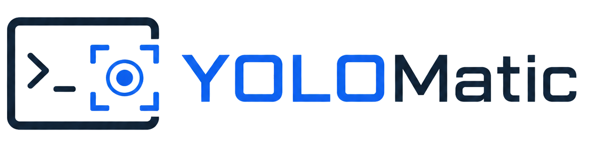

# YOLOmatic

{ width="520" }

**Train computer-vision models from one terminal.** YOLOmatic is a Python
terminal app that configures, trains, fine-tunes, benchmarks and exports
**YOLO26, YOLOv12, YOLO11, YOLOv10, YOLOv9, YOLOv8, YOLOX, RF-DETR, SAM 3.1 and
Detectron2** models for object detection, segmentation and pose estimation.
Everything runs on your own machine.

<video controls preload="none" playsinline width="100%" poster="assets/showreel/poster.jpg" aria-label="YOLOmatic showreel, 40 seconds">
  <source src="assets/showreel/yolomatic-showreel.mp4" type="video/mp4">
  Your browser cannot play this video. <a href="assets/showreel/yolomatic-showreel.mp4">Download the YOLOmatic showreel (MP4)</a>.
</video>

## Quickstart

```sh
uv tool install --python 3.12 git+https://github.com/shahabahreini/YOLOMatic@v7.0.0
yolomatic
```

`yolomatic` opens the interactive wizard. Choose **Configure Model**, pick a
model and a dataset, save the generated config, then choose **Train Model**.
The [install guide](getting-started/install.md) covers optional extras and CUDA
setup; the [first training run](getting-started/first-training-run.md) walks
through a complete run.

## Why YOLOmatic

- **Configs written for you.** The wizard reads your dataset and hardware and
  writes a training YAML with batch size, workers and device chosen for CUDA,
  Apple Silicon (MPS) or CPU.
- **Checks before training starts.** CUDA/PyTorch mismatches and missing runtime
  libraries are caught up front, with a repair path or CPU fallback offered.
- **One tool for the whole loop.** Dataset conversion and splitting, offline
  augmentation, training, prediction, benchmarking, export and upload share one
  menu.
- **Local by default.** Roboflow, ClearML and the Ultralytics Platform are used
  only when you choose them.

## Core workflows

| Workflow | Command | Output |
| --- | --- | --- |
| Configure training | `yolomatic` (Configure Model) | YAML config for the selected model and dataset |
| Train | `yolomatic train --config <file>` | Checkpoints, logs, exports, optional Roboflow upload |
| Predict | `yolomatic predict --weight <file> --source <path>` | Annotated images or batch inference results |
| Prepare data | `yolomatic prepare --source <dir or .ndjson>` | Validated, converted and split dataset |
| Benchmark | `yolomatic benchmark` | HTML report with mAP, F1, rankings and UMAP |
| Export | `yolomatic export --weight <file>` | ONNX, TensorRT, OpenVINO, CoreML, TFLite and more |
| Segment with SAM | `yolomatic sam` | Auto, text-prompted or box-prompted masks |

See [CLI commands](reference/cli-commands.md) for every flag and exit code.

## Model families

| Family | Tasks in YOLOmatic | Trainer |
| --- | --- | --- |
| YOLO26 | Detection, instance and semantic segmentation, pose | Ultralytics |
| YOLOv12 / YOLO11 / YOLOv9 / YOLOv8 | Detection, instance segmentation (YOLO11 and YOLOv8 also pose) | Ultralytics |
| YOLOv10 / YOLOX | Detection | Ultralytics |
| RF-DETR | Detection, instance segmentation, pose (preview) | Native RF-DETR |
| SAM 3.1 | Text-prompted segmentation and mask fine-tuning | Hugging Face Transformers |
| Detectron2 | Detection, instance segmentation | Detectron2 |

## Learn more

- [Install YOLOmatic](getting-started/install.md)
- [Run the quickstart](getting-started/quickstart.md)
- [Choose a model family](guides/models.md)
- [Prepare datasets](guides/datasets.md)
- [Export for deployment](guides/export.md)
- [Compare YOLOmatic with other tools](comparison.md)
- [Cite YOLOmatic](citation.md)
